<!--
  ╔══════════════════════════════════════════════════════════════╗
  ║  THEME: "Midnight Aurora"                                    ║
  ║  Background #0D1117 · Cyan #00F5D4 · Violet #9B5DE5 · Pink #F15BB5 ║
  ╚══════════════════════════════════════════════════════════════╝
-->

<div align="center">



<a href="https://github.com/amritunveiled">
  
</a>

<br/>


<p>
  <a href="#-about-me"><b>About</b></a> &nbsp;•&nbsp;
  <a href="#-tech-arsenal"><b>Stack</b></a> &nbsp;•&nbsp;
  <a href="#-featured-projects"><b>Projects</b></a> &nbsp;•&nbsp;
  <a href="#-github-analytics"><b>Analytics</b></a> &nbsp;•&nbsp;
  <a href="#-lets-connect"><b>Connect</b></a>
</p>


</div>

<h2 align="center">🧬 About Me</h2>

I'm a **Bachelor of Engineering student at RNS Institute of Technology**, specializing in **Artificial Intelligence & Machine Learning (AIML)**. My passion lives at the intersection of **mobile technology** and **intelligent systems**: I love building user-friendly applications and exploring how AI can solve real-world problems.

```python
class AmritRaj:
    name       = "Amrit Raj"
    role       = "B.E. Student · Artificial Intelligence & Machine Learning"
    institute  = "RNS Institute of Technology"
    location   = "Bengaluru, Karnataka, India"
    passion    = ["Mobile Technology", "Intelligent Systems"]
    mission    = "Build user-friendly apps where AI solves real-world problems"

    def say_hi(self):
        return "Let's build something that matters ✨"
```

<div align="center">
<table>
  <tr>
    <td width="50%" valign="top">
      🔭 <b>Currently Building</b><br/><br/>
      Cross-platform mobile apps integrated with ML models
    </td>
    <td width="50%" valign="top">
      🌱 <b>Currently Learning</b><br/><br/>
      Flutter / React Native · Deep Learning architectures · Cloud deployment
    </td>
  </tr>
  <tr>
    <td width="50%" valign="top">
      👯 <b>Open To Collaborate On</b><br/><br/>
      Open-source AI projects &amp; innovative app development ideas
    </td>
    <td width="50%" valign="top">
      💬 <b>Ask Me About</b><br/><br/>
      Python · Mobile UI/UX · Neural Networks
    </td>
  </tr>
</table>
</div>

<div align="center">

</div>

<h2 align="center">🧰 Tech Arsenal</h2>

<div align="center">
<table>
  <tr>
    <td align="right"><b>Languages</b></td>
    <td></td>
  </tr>
  <tr>
    <td align="right"><b>AI &amp; Data</b></td>
    <td></td>
  </tr>
  <tr>
    <td align="right"><b>Backend &amp; Cloud</b></td>
    <td></td>
  </tr>
  <tr>
    <td align="right"><b>Tools &amp; Hardware</b></td>
    <td></td>
  </tr>
  <tr>
    <td align="right"><b>Exploring</b></td>
    <td></td>
  </tr>
  <tr>
    <td align="right"><b>Creative</b></td>
    <td>
      
      
    </td>
  </tr>
</table>
</div>

<div align="center">

</div>

<h2 align="center">🚀 Featured Projects</h2>

<div align="center">
<table>
  <tr>
    <td width="33%">
      <a href="https://github.com/amritunveiled/GharWapsi">
        
      </a>
    </td>
    <td width="33%">
      <a href="https://github.com/amritunveiled/HealthSense-AI">
        
      </a>
    </td>
    <td width="33%">
      <a href="https://github.com/sushii-12/VoxFusion">
        
      </a>
    </td>
  </tr>
</table>
</div>

| Project | What it does | Highlights |
|:--|:--|:--|
| 🧭 **[GharWapsi](https://github.com/amritunveiled/GharWapsi)** | An affordable, real-time IoT system that helps find missing persons | GPS tracking hardware · community-powered mobile reporting · `C++` |
| 🩺 **[HealthSense-AI](https://github.com/amritunveiled/HealthSense-AI)** | An AI-powered educational assistant for understanding health and wellness topics | AI assistant · `Python` |
| 🎙️ **[VoxFusion](https://github.com/sushii-12/VoxFusion)** | Detects voice-cloning family-emergency scams before they land | Speaker verification · deepfake detection · scam-intent analysis · `Python` |

<div align="center">

</div>

<h2 align="center">📊 GitHub Analytics</h2>

<div align="center">


<br/>


<br/>


<br/>

<!-- Snake animation: appears after the "Generate Snake Animation" workflow runs once -->
<picture>
  <source media="(prefers-color-scheme: dark)" srcset="https://raw.githubusercontent.com/amritunveiled/amritunveiled/output/github-snake-dark.svg" />
  <source media="(prefers-color-scheme: light)" srcset="https://raw.githubusercontent.com/amritunveiled/amritunveiled/output/github-snake.svg" />
  
</picture>


</div>

<div align="center">

</div>

> [!TIP]
> **Got an idea involving AI and mobile apps?** I'm always open to collaborating on open-source AI projects and innovative app development. Reach out through any channel below.

<h2 align="center">🤝 Let's Connect</h2>

<div align="center">

<a href="https://linkedin.com/in/amritunveiled"></a>
<a href="mailto:amritrajaiml@gmail.com"></a>
<a href="https://instagram.com/amritunveiled"></a>
<a href="https://youtube.com/@amritunveiled"></a>
<a href="https://pinterest.com/amritunveiled"></a>

<br/><br/>

<!-- Optional: delete this block if you'd rather not show a support link -->
<a href="https://paypal.me/amrit5910"></a>

<br/><br/>

<sub>Crafted with 💜 in Bengaluru &nbsp;·&nbsp; Theme: <b>Midnight Aurora</b></sub>

</div>


